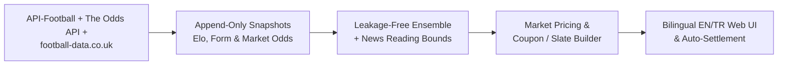

# EnvoraSports — Open-Source Football Prediction & Market-Intelligence Platform

<p align="center">
  <strong>Self-hosted football analytics, statistical probability modeling, and odds market-intelligence engine built with Next.js 15, Prisma, and PostgreSQL.</strong><br/>
  Ingests fixtures, live odds, and historical results; runs leakage-free statistical ensembles with news adjustments; builds self-settling prediction slates; and ships with a bilingual English/Turkish UI.
</p>

<p align="center">
  
  
  
  
  
</p>

Bilingual by default: English is the source language and served unprefixed (`/matches`), Turkish is prefixed (`/tr/matches`).



---

## Getting started

```bash
npm install
cp .env.example .env          # fill in the values
npm run db:deploy             # apply migrations
npm run db:seed               # markets, leagues, plans, settings
npm run dev                   # http://localhost:6247
```

Create an administrator:

```bash
npm run admin:create you@example.com
```

The password is printed once and stored only as a scrypt hash.

---

## How it runs

The system does **not** run daily. It runs on **publication days** and prepares a
forward window of match days:

- Monday → Tuesday, Wednesday, Thursday
- Thursday → Friday, Saturday, Sunday

Both follow one rule: a publication covers the next `coverageDays` days starting
`coverageOffsetDays` later. Weekday, offset, length, publish time, timezone and
grouping are all editable at `/admin/settings/schedule`.

Jobs are triggered over HTTP so any scheduler works — Vercel Cron, GitHub
Actions, an external cron:

```bash
curl -X POST -H "Authorization: Bearer $JOB_TRIGGER_SECRET" \
  http://localhost:6247/api/jobs/bulletin-publication
```

| Job | Cadence | Does |
|---|---|---|
| `bulletin-publication` | publication days | fixtures → prices → features → predictions → coupons |
| `fixture-topup` | daily | fills window days the provider could not serve yet |
| `rebuild-features` | after a history import | replays Elo chronologically |
| `narrate-analyses` | daily | paced narration into the cache |
| `result-sync` | frequently | kickoff-aware polling, then settlement |
| `settlement` | frequently | sweeps anything the result sync missed |
| `historical-import` | on demand | bulk seasons from the CSV archive |

A non-publication day returns `SKIPPED` with a reason and spends no provider
quota. `GET /api/health` reports the schedule, coverage window, quota and recent
runs.

---

## Data sources

| Source | Role | Cost |
|---|---|---|
| API-Football | fixtures, live status, results, statistics | 100 requests/day (free) |
| The Odds API | the bulletin — which markets are actually priced | 500 credits/month (free) |
| football-data.co.uk | years of results with opening **and closing** prices | unmetered |

Quotas are enforced before every outbound call, counted in credits, and shared
across processes via the database. Free-tier limits shape real behaviour — see
[ARCHITECTURE.md §15](ARCHITECTURE.md) for what they actually prevent.

---

## Scripts

```bash
npm run test                 # 231 tests
npm run typecheck
npm run lint
npm run db:studio

npx tsx scripts/import-history.ts 2025,2024   # bulk seasons
npx tsx scripts/rebuild-elo.ts
npx tsx scripts/run-pipeline.ts               # features → predictions → coupons, no API calls
npx tsx scripts/run-backtest.ts "name" 2026-01-01 2026-06-01 500
npx tsx scripts/sweep-backtest.ts             # threshold sweep
```

---

## Principles the code holds to

**No leakage.** Every feature is dated and every query filters on a knowledge
cutoff. Odds, Elo ratings and form snapshots are append-only, so a backtest
cannot read a number that did not exist yet.

**No invented data.** A market the bulletin does not price is not recommended. A
model with no data reports itself unavailable rather than guessing, and its
weight is redistributed. Narration is checked against its input payload and
rejected if it prints a figure the engine did not compute.

**No guarantees.** Probabilities are estimates. The banned-language check is
enforced in code, and it understands negation so the required disclaimer is not
itself flagged.

**Money is decimal.** Stakes, returns and system-coupon columns never touch
floating point.

Full design notes, index reasoning, leakage analysis, provider limitations and
backtest findings: [ARCHITECTURE.md](ARCHITECTURE.md).

---

## Contributing

Contributions are welcome — see [CONTRIBUTING.md](CONTRIBUTING.md).

## Security

See [SECURITY.md](SECURITY.md) for vulnerability reporting and deployment checklist.

## License

Released under the [MIT License](LICENSE).
